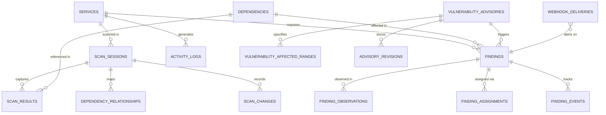

# DEPENDENCY WATCH — SYSTEM DESIGN & ARCHITECTURE SPECIFICATION

**Product:** Dependency Watch — Advanced Software Supply Chain Security Platform  
**Design Reference:** Velocitus Cyber-Engineering Aesthetic  
**Specification Date:** 2026-11-18

---

## 1. Visual Identity & UI/UX Design System

### 1.1 Aesthetic Direction

The design of Dependency Watch is informed by the **Velocitus** aesthetic: an uncompromising, high-contrast, technical interface engineered for enterprise security operations. Rather than adopting typical corporate SaaS tropes (such as generic pastel gradients, playful illustrations, or rounded toy-like components), Dependency Watch delivers a dark, tactical, editorial cybersecurity product.

#### Visual Tenets
- **Deep Blacks & Carbon Surfaces:** Canvas built on pure `#080808` black with `#111111` card backdrops and `#171717` panels, creating dramatic depth.
- **Precision Accents:** High-intensity signal crimson (`#E50932`) and deep red (`#C8102E`) used selectively for critical alerts, active focus, and visual anchors.
- **Architectural Wireframes:** Isometric geometric wireframe SVG illustrations (`Wireframe.tsx`) representing active attack surfaces and dependency networks.
- **Technical Typography:** Monospaced data blocks for package coordinates, hashes, and advisory IDs; bold, uppercase editorial typography for section headings.
- **Subtle Glow & Technical Gridlines:** Backgrounds feature 40px subtle technical grid lines with radial red-to-transparent ambient glows in hero panels.

---

### 1.2 Design Tokens & Color Palette

| Token Name | Hex Code | Visual Application |
| :--- | :--- | :--- |
| `bg-main` | `#080808` | Primary page canvas background |
| `bg-secondary`| `#111111` | Secondary containers, sidebar base, and metric cells |
| `bg-panel` | `#171717` | Cards, data tables, and modal dialogs |
| `bg-elevated` | `#202020` | Hover states, active dropdown options, and elevated headers |
| `border-subtle`| `#242424` | Secondary divider lines and chart grids |
| `border-base` | `#303030` | Standard component borders and table outlines |
| `text-primary`| `#F5F5F5` | Headings, active values, and primary labels |
| `text-secondary`| `#A4A4A4` | Body descriptions, table cell text, and metadata keys |
| `text-muted` | `#686868` | Timestamps, inactive tabs, and technical annotations |
| `accent-primary`| `#E50932` | Primary brand red, active links, and call-to-action buttons |
| `accent-crimson`| `#C8102E` | Secondary red accents and high-severity highlights |
| `accent-magenta`| `#A90052` | Gradient stops in major hero headers |
| `status-critical`| `#FF3030` | Critical priority badges and immediate action sirens |
| `status-success` | `#38B779` | Resolved badges, healthy status pills, and passed checks |

---

### 1.3 Typography Hierarchy

1. **Editorial & Major Headings:** `Space Grotesk`, sans-serif. High tracking, bold weights, uppercase style with editorial slash indexes (e.g. `01 / REGISTRY`).
2. **Interface & Body Typography:** `Inter`, sans-serif. Neutral, highly legible at small sizes (12px–14px), optimized for information-dense data tables.
3. **Identifiers, Hashes & Code:** `JetBrains Mono`, monospace. Used for version strings (e.g. `6.5.2`), advisory codes (e.g. `DW-2026-0001`), lockfile paths, and raw JSON payloads.

---

## 2. System Architecture & End-to-End Data Pipeline

```
+----------------------------------------------------------------------------------------------------+
|                                         DEPENDENCY WATCH                                           |
+----------------------------------------------------------------------------------------------------+
                                                   |
      [1. Ingestion]                               |      [2. Advisory Feed]
+--------------------------+                       |  +------------------------+
| 8 Microservices (Kit)    |                       |  | OSV Feed Server (7100) |
| - service.yaml           |                       |  | - JSON /v1/advisories  |
| - package-lock.json (v3) |                       |  | - Feed 1 / Feed 2      |
| - requirements.lock/txt  |                       |  +-----------+------------+
+------------+-------------+                       |              |
             |                                     |              v
             v                                     |  +------------------------+
+--------------------------+                       |  | Feed Importer          |
| Manifest Scanner         |                       |  | - Advisory Revisions   |
| - Path-based Instances   |                       |  | - Disjoint Event Ranges|
| - pip-compile # via Tree |                       |  +-----------+------------+
| - Unresolved Specifiers  |                       |              |
+------------+-------------+                       |              |
             |                                     |              |
             +---------------------+---------------+--------------+
                                   |
                                   v
             +-------------------------------------------+
             |         Version & Matching Engine         |
             | - SemVer 2.0 (npm) / PEP 440 (PyPI)       |
             | - PEP 503 Canonical Name Normalization    |
             | - Active vs Withdrawn Corroboration       |
             +---------------------+---------------------+
                                   |
                                   v
             +-------------------------------------------+
             |        Risk & Remediation Engine          |
             | - Deterministic Heuristic Scoring (0-10+) |
             | - Advisory Severity One-Band Cap          |
             | - Range-Bound Safe Version Recommendation |
             +---------------------+---------------------+
                                   |
                                   v
             +-------------------------------------------+
             |     Finding Lifecycle & State Machine     |
             | - Open -> In Progress -> Resolved         |
             | - Mandatory Verification Scan Gate        |
             | - Reappearance Auto-Reopen Detection      |
             +---------------------+---------------------+
                                   |
         +-------------------------+-------------------------+
         |                                                   |
         v                                                   v
+--------------------------+                       +-------------------+
| Deduplicated Webhooks    |                       | SQLite Database   |
| - Critical Alert JSON    |                       | (SQLAlchemy 2.0)  |
| - Receiver Verification  |                       | 16 Indexed Tables |
+--------------------------+                       +-------------------+
```

---

## 3. Dependency Scanner Design

### 3.1 npm Lockfile v3 Recursive Parser
- **Instance Isolation by Path:** In npm lockfile v3, a package may appear multiple times with different versions depending on transitive requirements. For instance, `notifications-svc` contains `node_modules/qs` (6.11.0, safe) and `node_modules/superagent/node_modules/qs` (6.5.2, vulnerable). The parser treats the install path as the unique instance key within each service scan, preserving both copies.
- **Direct vs. Transitive Identification:** Packages listed in the root `package.json` dependencies are marked `direct = true`. All child packages located deeper in the graph are tagged `direct = false`.
- **Development Scoping:** Packages marked `"dev": true` in the lockfile retain a `dev_only` flag.

### 3.2 Python Lockfile & Manifest Parser
- **pip-compile Dependency Tree Extraction:** In `requirements.lock`, parent-child relationships are preserved via `# via` comment strings. The parser builds a directed graph connecting packages to their direct parents (e.g. `cryptography` $\rightarrow$ `pyjwt` $\rightarrow$ `policy-svc`).
- **Development Requirements (`requirements-dev.txt`):** Separate test manifests (e.g. in `kyc-svc`) are ingested and tagged `dev_only = true`.
- **Honest Unresolved Manifest Handling:** `docs-gen-svc` contains only `requirements.txt` with loose version ranges (`Jinja2>=2.10,<3.1`, `pyyaml>=5.1`, `Markdown~=3.3`). Because no exact installed snapshot exists:
  - The scanner records them with `version = null` and `resolved = false`.
  - It does **not** assume an arbitrary version.
  - It does **not** generate definitive vulnerability findings.
  - Potential matches against advisories are surfaced in a dedicated `findings/unverified` table for operator review.

---

## 4. Vulnerability Ingestion & Matching Engine

### 4.1 OSV Advisory Normalization
Each advisory fetched from the feed server is stored with its full original JSON in `advisory_revisions`. The parser extracts:
- Canonical package names using PEP 503 rules (`lowercase`, collapsing `.`, `_`, and `-`).
- Disjoint event boundaries (`introduced` $\rightarrow$ `fixed`).
- Raw severity string (preserving `CRITICAL`, `HIGH`, `MODERATE`, `LOW`).

### 4.2 Ecosystem-Aware Range Engines
- **SemVer (Node.js):** Custom comparison engine supporting major, minor, patch, pre-release identifiers, and operators (`<`, `<=`, `>`, `>=`, `=`).
- **PEP 440 (Python):** Complete implementation handling epoch numbers, post-releases, dev-releases, and standard clause sets.

### 4.3 Advisory Lifecycle Transitions
- **Modifications:** Updates to severity (e.g. DW-2026-0009 `werkzeug` changing from MODERATE to HIGH) trigger recalculation of heuristic scores for active findings.
- **Withdrawals:** When an advisory contains a `withdrawn` timestamp (e.g. DW-2026-0010 `urllib3`), associated findings are marked `Resolved` with resolution reason `withdrawn`. They are removed from active counts while remaining in historical audit logs.

---

## 5. Risk Prioritization Heuristic & Severity Cap

### 5.1 Objective
Standardize vulnerability prioritization across disparate microservices without misrepresenting qualitative advisory tags as CVSS scores.

### 5.2 Deterministic Formula

$$\text{Raw Score} = S + T + I + F + C + D$$

Where:
- **$S$ (Advisory Severity):** `CRITICAL` = +8, `HIGH` = +5, `MODERATE` = +3, `LOW` = +1
- **$T$ (Service Tier):** Tier 1 = +3, Tier 2 = +2, Tier 3 = +0
- **$I$ (Internet Exposure):** Internet-facing = +2, Internal = +0
- **$F$ (Fix Availability Penalty):** No known fix published in feed = +1, Known fix exists = +0
- **$C$ (Upgrade Complexity):** Major upgrade = +2, Minor = +1, Patch = 0, Unknown = +1
- **$D$ (Development Scope Deduction):** `dev_only` = -2, Runtime = 0
- **Floor:** Clamped at $\ge 0$.

### 5.3 Priority Bands
- **Critical:** Score $\ge 10$
- **High:** Score $7 - 9$
- **Medium:** Score $3 - 6$
- **Low:** Score $0 - 2$

### 5.4 One-Band Severity Cap
To prevent an edge-facing Tier 1 service from inflating a genuinely minor advisory to Critical, the computed priority is capped at one band above the raw feed severity:
- `LOW` feed severity $\rightarrow$ Capped at **Medium** (max score 6)
- `MODERATE` feed severity $\rightarrow$ Capped at **High** (max score 9)
- `HIGH` feed severity $\rightarrow$ Capped at **Critical** (max score 15)
- `CRITICAL` feed severity $\rightarrow$ **Critical** (no cap applied)

The transparent score breakdown provides an explicit item showing the cap adjustment when applied.

---

## 6. Remediation Guidance Engine

1. **Range-Bound Safe Version Selection:**
   - The engine selects a target version only from the affected range that contains the installed version.
   - For DW-2026-0001 (ranges: `< 6.7.3` and `>= 6.8.0, < 6.8.3`):
     - For `qs@6.5.2`, it recommends `6.7.3`.
     - For `qs@6.8.1`, it recommends `6.8.3`.
2. **Open-Ended Ranges (No Invented Fixes):**
   - For DW-2026-0014 (`body-parser`) which specifies no fixed event, the engine explicitly reports: "No fix published; apply mitigation or monitor advisory updates."
3. **Transitive Dependency Parent Resolution:**
   - For transitive vulnerabilities, the engine traces parent edges back to the nearest direct dependency declared in the service's root manifest, advising engineers exactly which root package requires upgrading.

---

## 7. Finding Lifecycle & SLA State Machine

### 7.1 States
- **Open:** Vulnerability detected; awaiting triage or remediation.
- **In Progress:** Assigned to an engineer; work underway.
- **Resolved:** Vulnerability remediated or advisory withdrawn.

### 7.2 Strict Verification Scan Gate
- An engineer cannot resolve a finding via API or UI while the vulnerable package is still installed.
- Transitioning to `Resolved` triggers an immediate service scan.
- If the vulnerable package persists, the request is rejected with `HTTP 409 Conflict: Vulnerable package instance still detected in latest scan`.

### 7.3 Reappearance Detection
- If a subsequent scan detects a package version matching an advisory that was previously marked resolved, the finding is automatically reopened and a `reopened` event is recorded.

### 7.4 SLA Due Dates & Overdue Daemon
- **Critical:** 1 day from discovery
- **High:** 7 days from discovery
- **Medium:** 30 days from discovery
- **Low:** 90 days from discovery
- A background worker (`overdue_scheduler`) evaluates finding due dates every 30 seconds and flags overdue items.

---

## 8. Webhook Notification Subsystem

### 8.1 Payload Schema
When a Critical finding is identified, the backend formats a standardized alert:

```json
{
  "event_type": "finding.critical",
  "service": "payments-svc",
  "package": "jsonwebtoken",
  "advisory_id": "DW-2026-0002",
  "severity": "HIGH",
  "priority": "Critical",
  "finding_id": 2,
  "reference": "https://dependency-watch.local/findings/2"
}
```

### 8.2 Deduplication & Receipt Verification
- Each notification is assigned a deterministic `delivery_key` (e.g. `finding.critical:2`). Subsequent scans will not resend duplicate alerts for the same finding.
- The delivery dispatcher sends HTTP POST to the webhook receiver (`http://localhost:9900/api/webhook`).
- Verification is confirmed by reading `GET /api/received` from the receiver to guarantee delivery.

---

## 9. Database Entity Model (Relational ERD)



### Key Table Schema Highlights

1. **`services`**: `id`, `name` (UNIQUE), `owner`, `tier`, `internet_facing`, `ecosystem`, `root_path`.
2. **`dependencies`**: `id`, `name`, `ecosystem`, `canonical_name` (UNIQUE index on `(ecosystem, canonical_name)`).
3. **`scan_results`**: `id`, `scan_id`, `dependency_id`, `package_path`, `version`, `specifier`, `resolved`, `direct`, `dev_only`, `manifest_file`.
4. **`vulnerability_advisories`**: `id`, `advisory_id` (UNIQUE), `summary`, `details`, `source_severity`, `published_at`, `modified_at`, `withdrawn_at`, `raw_payload_json`.
5. **`findings`**: `id`, `logical_key` (UNIQUE on `service_id + package_path + advisory_id`), `status`, `priority`, `heuristic_score`, `score_breakdown_json`, `due_date`, `assigned_to`, `resolved_at`.
6. **`webhook_deliveries`**: `id`, `delivery_key` (UNIQUE), `event_type`, `endpoint_url`, `request_payload_json`, `response_status_code`, `status`.
